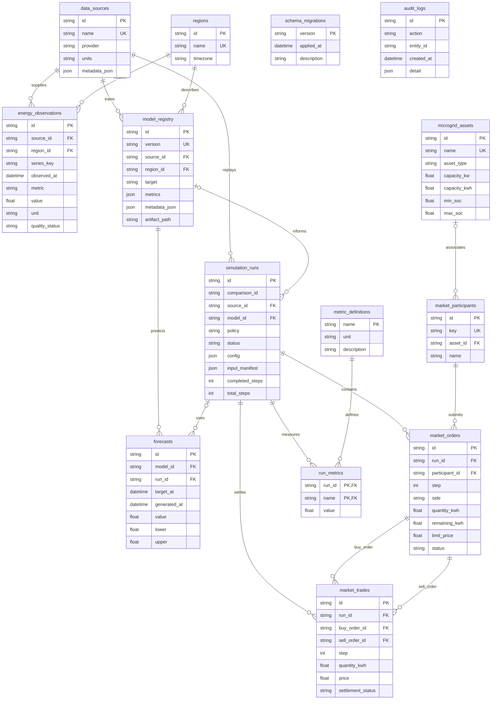
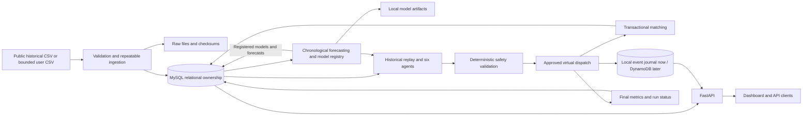
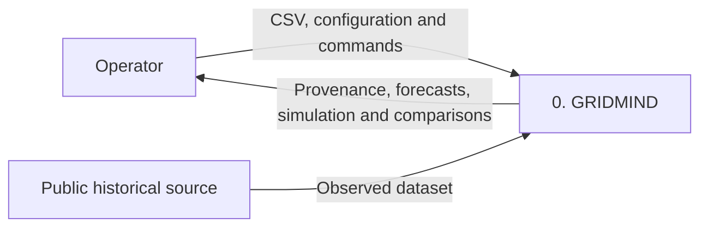
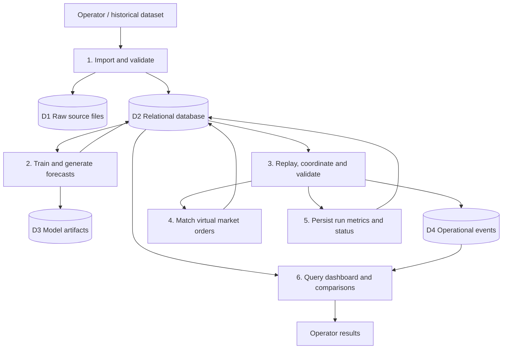
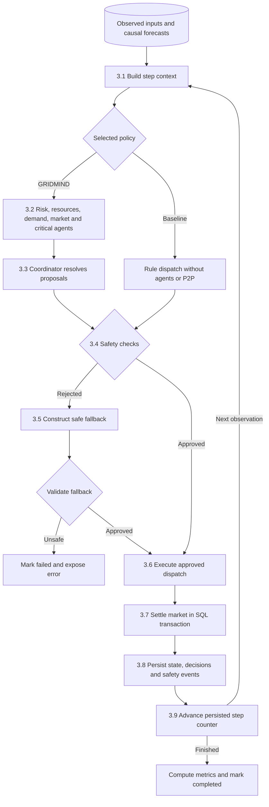

# GRIDMIND database design and demonstration

This document describes the implementation in `backend/gridmind/models.py`, `database.py`, `events.py`, `market.py`, `runner.py` and `analytics.py`. MySQL is the intended relational backend. SQLite is an explicitly labelled compatibility option, not evidence that MySQL has been tested. AWS is deferred; the default operational store is a durable local event journal implementing the same application contract as the optional DynamoDB adapter.

## Entity relationships

The schema has 14 tables and one analytical view, including canonical metric definitions and schema migration history. Domain IDs are application UUID strings; metric definitions use the metric name, schema migrations use the version, and `run_metrics` uses a composite key. `comparison_id` groups paired runs; there is no comparison entity table. Audit entity references are deliberately polymorphic application references and are not foreign keys.



Optional foreign keys are `simulation_runs.model_id`, `forecasts.run_id` and `market_participants.asset_id`. The diagram abbreviates descriptive fields; the version-controlled SQL and SQLAlchemy models contain the complete schema. Numerical `float` fields in this conceptual diagram use `Float(53)` in the models and DOUBLE on MySQL. This preserves simulation precision without claiming exact decimal financial-ledger arithmetic.

## Normalization and integrity

* **1NF:** each observation, forecast, order and trade occupies its own row. Lists of trades and participant names are not repeated inside run rows. JSON metadata, configurations and manifests are opaque provenance documents; their internal structures are not asserted to satisfy relational normal forms.
* **2NF:** observations have the natural identity `(source_id, region_id, series_key, metric, observed_at)`. A reading belongs to that complete identity. Sources and regions reside in their own tables rather than repeating their descriptions in readings. `run_metrics(run_id, name, value)` has `(run_id, name)` as its key; value depends on the entire key. The partial dependency `name → unit` is removed into `metric_definitions(name, unit, description)`.
* **3NF:** source provider data is reached through `source_id`; geographical metadata through `region_id`; model version data through `model_id`; participant identity through `participant_id`. A trade references its buy/sell orders instead of duplicating their participant details. Run configuration and input manifests intentionally freeze assumptions for reproducibility.
* **BCNF scope:** in `metric_definitions`, name determines unit/description and is a candidate key. In `run_metrics`, the complete `(run_id, name)` key determines value. Those relations satisfy BCNF under their stated dependencies. Sources, regions and participants likewise separate descriptive facts from referencing records. The trade ledger deliberately materializes run/step for scoped queries and foreign keys; both order references must match that same scope. That bounded denormalization and opaque JSON snapshots are explicitly outside a blanket BCNF claim. Surrogate keys alone do not prove a relation is normalized.

Important enforced constraints:

| Relation | Database enforcement |
|---|---|
| `energy_observations` | Unique natural identity; nonnegative readings; valid source/region FKs |
| `microgrid_assets` | Positive power, nonnegative energy, supported type, `0 ≤ min_soc < max_soc ≤ 1`; battery energy positive |
| `simulation_runs` | Allowed policies/statuses; `0 ≤ completed_steps ≤ total_steps` |
| `forecasts` | Model FK, optional run FK; unique `(model_id, run_id, target_at)` for linked run predictions |
| `market_orders` | Buy/sell only; positive quantity; nonnegative price; remaining quantity in `[0, quantity]`; one order per run/step/participant/side |
| `market_trades` | Positive energy, nonnegative price, distinct orders; unique buy/sell order pair; composite order/run/step FKs; INSERT/UPDATE guards enforce sides, distinct participants, price bands and cumulative allocation |
| `run_metrics` | One value per run and metric; valid run and canonical metric FKs |
| `metric_definitions` | One canonical unit and definition per metric name |
| `schema_migrations` | One successful application record per schema version |

Application validation additionally checks finite numbers, timestamp semantics, scenario consistency, asset bounds and energy availability. Foreign keys cannot enforce run references in DynamoDB or a local journal. The API checks that a relational run exists before exposing its event history.

The forecast unique constraint alone does not deduplicate standalone predictions:
SQL permits multiple NULL `run_id` values in that unique key. `forecast_service.py`
therefore generates a deterministic primary key from model, input-history hash
and target time for standalone predictions. Repeat and overlapping-horizon
requests reuse those rows. Ordinary imported observation IDs use application
UUIDs; their natural unique key and import validation enforce repeat safety.

## Hybrid ownership and architecture

| Storage | Owned records | Purpose |
|---|---|---|
| MySQL | Sources, regions, observed measurements, assets, model registry, forecasts, run metadata, participants, orders, trades, final metrics, audit | Referential integrity, relational queries and atomic market settlement |
| Operational event backend | Modelled state snapshots, structured agent decisions, safety validation outcomes | Ordered run/step histories with flexible versioned payloads |
| Local filesystem | Original downloaded/uploaded CSV or live JSON, checksum provenance, serialized model artifacts | Traceable source evidence and loadable model versions |

The event backend is not a duplicate of the relational database. High-frequency states do not become observation rows; simulated battery values are never training labels presented as measurements.



## Data-flow diagrams

**Level 0 — system context:** the operator provides datasets, asset assumptions and run parameters. GRIDMIND produces source histories, predictions, simulated behaviour and comparisons. It has no actuator or physical-grid control connection.



**Level 1 — major processes:** stores D1–D4 match actual persistence responsibilities.



**Level 2 — decomposition of process 3:** all numerical decisions pass deterministic validation. Baseline uses its documented rule dispatch and the same safety boundary.



## Operational key design

Table name when DynamoDB is enabled: **`GridMindSimulationEvents`**.

* Partition key: `PK = RUN#<UUID>`.
* Sort key: `SK = STEP#<8-digit-step>#<EVENT_TYPE>#<20-character-event-hash>`.
* Attributes: `run_id`, `step`, `event_type`, `schema_version: 1`, original observation `timestamp`, structured `payload`.
* A run history uses partition-key equality; a step uses a sort-key prefix. Event categories are filtered within the run history. No secondary index is justified by the implemented query requirements.
* `after` is an ordered sort-key cursor; `limit` bounds API results. Different categories share a step prefix. Never interpret the hash order of same-step agent events as causal agent execution order.
* Identical key/content retries are idempotent. Reusing a key for different content raises a conflict. The local store uses atomic file replacement; the DynamoDB adapter uses a conditional put and verifies an existing item. The adapter retries selected transient service errors with bounded backoff.

```python
# Invoke with an actual run ID; this is the adapter's query contract.
store.query(run_id, event_type="STATE", limit=1000)
store.query(run_id, step=10, event_type="AGENT_DECISION", limit=1000)
```

The equivalent DynamoDB primary access is `PK = :run`; step retrieval adds `begins_with(SK, :step_prefix)`. The local journal preserves these keys for migration readiness, but is not a DynamoDB emulator.

## Transaction and failure behaviour

`market.py` uses a relational transaction for order insertion, a locked run row that serializes its order book, compatible matching, decrementing both remaining quantities and recording settled trades. Buys are sorted by highest limit price first, sells by lowest limit price first, and equal-price ties follow incoming proposal order. That list position is the arrival-order rule; SQL `created_at` timestamps are not used for matching. Compatible orders settle at `(buy_limit + sell_limit) / 2`. Quantities are checked against modelled available energy and served-load purchasing limits. Pair uniqueness and run/step/participant/side uniqueness protect duplicate execution; repeat settlement also verifies that incoming orders match the already committed step. Exceptions roll back the transaction. SQLite lacks MySQL row-level `FOR UPDATE` semantics; use the MySQL backend to demonstrate locking behaviour.

No transaction spans SQL and the operational store. A step settles the market, writes operational events, then advances the SQL step counter. A failure can therefore leave committed market records and incomplete events. When SQL remains reachable, the error handler marks the run failed rather than completed, and `completed_steps`, events and market rows make partial progress inspectable. A SQL outage can prevent even that status write; an unfinished row may remain active until recovery. Persisted queued/running/paused runs become `interrupted` on application restart; execution is not automatically resumed. Pause and resume operate within the current application session at complete step boundaries. Create a new run after investigation of an interruption. Event idempotency is not a claim of a distributed atomic commit.

For MySQL, `trg_run_status_audit` records changed run status in `audit_logs`, including updates from another SQL client. It does not fire when the status is unchanged. Asset and ingestion/model operations produce application audit entries. The trigger is MySQL-specific and is not claimed to exist in the SQLite compatibility backend.

The other two installed triggers are `trg_trade_guard_insert` and
`trg_trade_guard_update`, on both MySQL and SQLite. At trade insertion/update,
they validate buy/sell sides, common run/step scope, different participants,
price compatibility and cumulative order allocations. These triggers do not
automatically settle arbitrary direct-SQL orders, update order status/remaining
quantities, or retroactively validate later edits to an order's price/quantity.
The application settlement transaction owns those coordinated updates. The
delivered MySQL schema therefore has three triggers; SQLite has the two trade
guards. No stored procedure is claimed.

## Queries to demonstrate

The Database lab retrieves table counts, source/region joins, the comparison view and live query plans/timings. These examples use the implemented names:

```sql
-- Provenance join and aggregation.
SELECT s.name AS source, r.name AS region, o.metric,
       COUNT(*) AS observations,
       MIN(o.observed_at) AS first_observation,
       MAX(o.observed_at) AS latest_observation
FROM energy_observations o
JOIN data_sources s ON s.id = o.source_id
JOIN regions r ON r.id = o.region_id
GROUP BY s.name, r.name, o.metric;

-- The analytical view links run grouping, policy and persisted metrics.
SELECT comparison_id, run_id, policy, status, metric, value, unit
FROM v_run_comparison
ORDER BY comparison_id, metric, policy;

-- Read an actual recorded trade and both normalized participants.
SELECT t.id, t.run_id, t.step, b.name AS buyer, s.name AS seller,
       t.quantity_kwh, t.price, t.settlement_status
FROM market_trades t
JOIN market_orders bo ON bo.id = t.buy_order_id
JOIN market_orders so ON so.id = t.sell_order_id
JOIN market_participants b ON b.id = bo.participant_id
JOIN market_participants s ON s.id = so.participant_id;

-- A real cross-store trace starts with a relational run.
SELECT id, comparison_id, policy, source_id, model_id, status,
       completed_steps, total_steps, input_manifest
FROM simulation_runs ORDER BY created_at DESC;
```

Select a returned UUID in the dashboard or query `/api/runs/<UUID>/events?event_type=STATE`; the resulting `PK` must be `RUN#` plus that exact UUID. The payload's `input_observation_id` links a modelled snapshot to the original `energy_observations.id`. Use the current API/database records for sample records and screenshots; no fixture value is evidence of a real imported measurement.

Declared indexes cover observation `(region_id, observed_at)` and `(metric, observed_at)`, run status/comparison grouping, forecast target time, market run lookup and `(run_id, step, side, limit_price)` order-book lookups. Matching itself sorts the proposed orders in Python; it does not run a SQL price-priority matching query against that index. Unique constraints also create useful indexes. `/api/db/demo` compares equivalent bounded observation queries with dialect-specific index hints. It warms each query, takes five timings, reports the median and returns query plans. It does not drop indexes, fabricate speedups or demonstrate production performance. The MySQL `IGNORE INDEX` comparison still exposes the actual optimizer plan; inspect that plan before calling the path a full table scan.

## Evaluation evidence and limits

The application inserts `run_metrics` and changes the run to completed in the same final SQL transaction; this is a service rule, not a CHECK constraint restricting all direct SQL clients. `v_run_comparison` uses inner joins and therefore contains only stored metric rows. It has no placeholder row for a run without metrics. The comparison API/dashboard also retrieves run metadata so failed, interrupted or cancelled runs remain visible with missing metrics rather than zeros. Paired policies share scenario settings, input manifest and seed. Measured differences can favour either policy and apply only to that modelled scenario.

The tests and project evaluation report, generated from the current implementation, are the source of verification results. MySQL-specific trigger/locking checks require a reachable MySQL server. AWS account configuration and live DynamoDB execution remain deferred until credentials and region are supplied. London subsets are UK household data; Karnataka supplied electricity is daily regional energy met rather than unrestricted demand or household telemetry. No stored record or chart establishes physical-grid control or real equipment-failure prediction.

